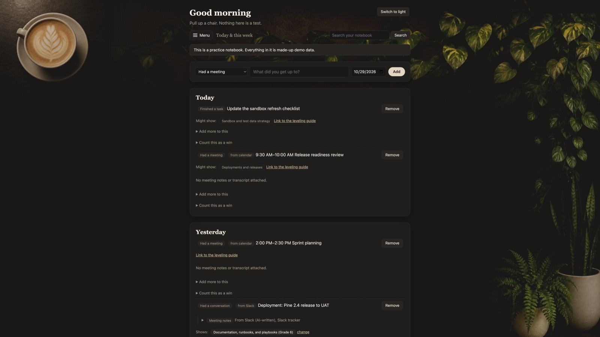
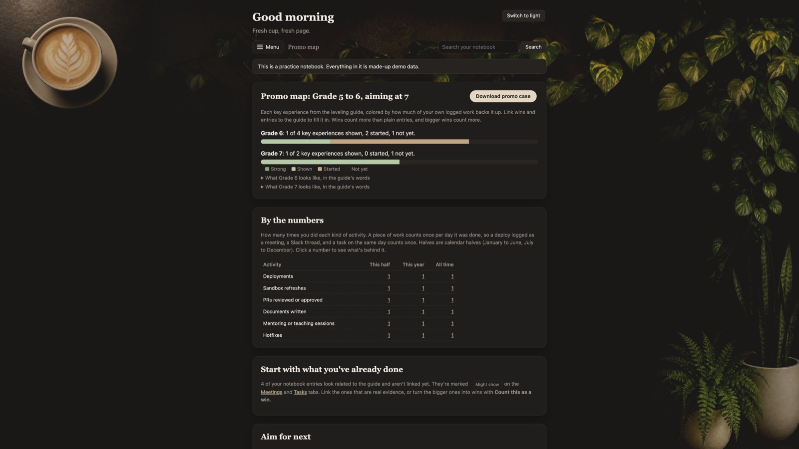

<h1 align="center">Career OS</h1>

<p align="center">
  <em>You were hired to do the work, not to write essays about the work.</em>
</p>

<p align="center">
  
</p>

---

Every year it's the same ritual. Promotion season opens, and a perfectly productive engineer stops shipping things to go on an archaeology dig through their own Slack history. *What did I do in March? Was that refresh mine? Who wrote that runbook? Probably me. Hopefully me.*

Two weeks later there's a promotion case and nothing got deployed. That's backwards.

**Career OS keeps the receipts so you don't have to.** It quietly collects what you actually did (meetings, Slack threads, tasks, the 9 PM hotfix), sorts it against your leveling guide, and keeps a running tally of the evidence. When it's time to make the case, the case is mostly already made.

You go back to doing the job. Which, conveniently, is also the best evidence for the promotion.

## What it does

1. **Collects, so you don't have to.** Twice a day it pulls in your Google Calendar meetings (once they've happened, with their Gemini notes), your Google Tasks, and your Slack activity tracker. You don't press anything. You don't fill in a form. You don't "log time."
2. **Sorts.** Claude reads each record and decides what it is (meeting, conversation, doc, task), which parts of the leveling guide it shows, and whether it's a win worth keeping.
3. **Counts once.** A deployment that shows up as a meeting, a Slack thread, *and* a task is one deployment, not three. Nobody likes a padded case, least of all the promotion committee.
4. **Shows the map.** The Promo map lays the leveling guide next to your evidence: what you've shown, what's strong, what's still a gap, and how many times you actually did the thing.
5. **Writes the case.** Press **Write my promo case** and Claude drafts it (Summary, Key accomplishments, Impact, Behaviors & values, Growth areas) from your own evidence, with a little [3] after every sentence pointing to where it came from. The app double-checks each sentence: no source, or a number that isn't in your data, and it's flagged **Check this**. Your manager can't fact-check you harder than this. Then edit it in place or have Claude rewrite one section; every change is a new draft you can compare.

<p align="center">
  
</p>

<p align="center"><sub>Both screenshots are the practice notebook: made-up records, a made-up release called "Pine," and zero real people. It's going to keep changing; the coffee stays.</sub></p>

## What it doesn't do

- **Invent things.** "Why it mattered" comes from you or from your own Slack tracker. No numbers you didn't produce, no outcomes that didn't happen.
- **Decide for you.** Everything Claude picks is marked **AI** until you check it, and every pick can be undone. One click: **Looks right**.
- **Live in the cloud.** The app and its database run on your laptop, on a local address only. No accounts, no server, no "we've updated our privacy policy."

## Get going

You'll need a Mac, [uv](https://docs.astral.sh/uv/), and Claude Code signed in to the Google Workspace and Slack connectors.

```
cd ~/Documents/career-os
uv run careeros notebook init        # makes your notebook (once)
uv run careeros schedule install     # keeps the app running and syncing, forever-ish
```

Then open **http://127.0.0.1:8765**. That's it. The schedule starts the app when you log in, syncs at 8 AM and 6 PM, backs everything up first, and only bothers you (with a notification) if something breaks.

Want to poke around without touching real data? Try the practice notebook:

```
uv run careeros demo seed --data-dir /tmp/cos-demo
uv run careeros serve --data-dir /tmp/cos-demo
```

## The daily routine

There isn't one. That's the point. But if you're the type who likes to check:

- **Morning:** glance at the **Intake Review Queue**. Green dots mean everything's in. Click **Looks right** on what's right, fix what isn't, **Remove** the meeting you didn't actually attend.
- **When something big happens:** **Count this as a win**, and write one sentence on why it mattered while you still remember.
- **Promotion season:** open the Promo map, click **Write my promo case**, read what comes back, fix the bits marked **Check this**, and enjoy the unfamiliar feeling of being early.

## Your data and Claude

The Sync buttons, the scheduled syncs, and Claude's read-through run the `claude` command on your computer. That sends the text being read (your Slack tracker, calendar events, meeting notes, tasks, and your records) to Claude, with Claude's built-in tools turned off, so it can read and answer but not wander around your laptop. Nothing else leaves the machine. Backups stay next to the notebook, so they guard against mistakes, not against losing the laptop.

## FAQ

**Is this cheating?**
No. It's remembering. The work is yours; the app just refuses to let you forget it.

**Will it make me sound amazing?**
It will make you sound exactly as amazing as you were, with sources. If that's not amazing enough, the Promo map's **Aim for next** has ideas.

**Does it read my Slack messages?**
It reads one canvas: the activity tracker your Slackbot automation writes each day about your own work. It doesn't go through your channels or DMs itself. (A planned kudos finder will search public channels only.)

**What if Claude gets something wrong?**
Then you click one button and it's fixed, and Claude won't touch that record again. It's an intern with excellent recall and no ego.

**Why the coffee shop?**
Because nobody ever wrote a good promotion case under fluorescent lights.

## What's next

The roadmap lives in [PLAN.md](PLAN.md) (what and why) and [IMPLEMENTATION_PLAN.md](IMPLEMENTATION_PLAN.md) (how). Coming up: export to Google Docs, GitHub and Google Docs as sources, capturing kudos, and a Friday digest.

For day-to-day details (every button, every command, every "wait, why did it do that"), see [INSTRUCTIONS.md](INSTRUCTIONS.md).

<details>
<summary><b>Under the hood</b></summary>

| Folder | What it does |
|---|---|
| `web/` | The local pages (loopback only), the background Sync jobs, and the Intake Review Queue |
| `google/` | Google Calendar, Google Tasks, and meeting-note summaries through Claude Code's Google Workspace connector |
| `slack/` | Reading the Slack tracker canvas, sorting its items, and importing them |
| `guide/` | The leveling guide, links from your work to it, grouping records into pieces of work, impact counts, the Promo map, and Claude's read-through |
| `promo/` | The promotion-case writer: the numbered evidence it's written from, and the checks on every sentence |
| `export/` | Downloads: wins and the evidence behind the Promo map as Markdown, and everything as CSV |
| `claude_cli.py` | Runs Claude Code headless for one narrow job, with built-in tools off |
| `sync_all.py`, `schedule.py`, `backup.py` | The scheduled sync, the two macOS launch agents, and daily backups |
| `fixtures/` | The practice notebook's made-up records, wins, and leveling guide |
| `storage/` | Database tables, removed-record and skip-rule bookkeeping, and the sync log |

Stack: Python 3.12, FastAPI, SQLAlchemy, SQLite, Jinja2, Typer. Tests: `uv run pytest`.

Principles the code holds to: Claude's picks stay marked AI until you check them; syncs never delete a record you built on (a win, a guide link, or your check); removed records stay removed; nothing leaves the laptop except through the Sync buttons and the Claude review.

The backdrop photos in `src/careeros/web/static/img/` were AI-generated for this project, each in a light and a dark version: the latte (`latte-*.jpg`), the pothos vine along the top (`vine-top-*.jpg`), and the pothos, snake plant, and fern down the right (`plants-right-*.jpg`). Each sits on a plain wall that drops out against the page. To swap one, keep the file name and the composition, and stay around 1500 px on the long side. README screenshots live in `docs/img/` and come from the practice notebook only.

</details>
